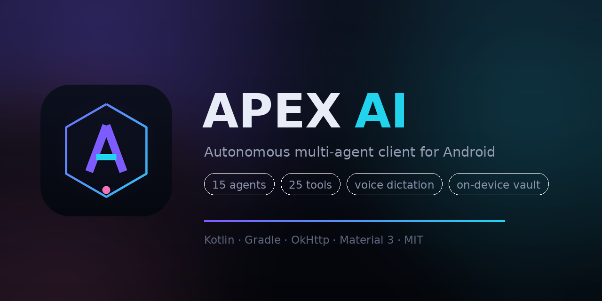

<p align="center">
  
</p>

<p align="center">
  <a href="https://github.com/1234567890933/ApexAI/actions/workflows/build-apk.yml"></a>
  
  
  
</p>

# Apex AI

An open-source Android client for large language models with a real agent runtime:
a streaming chat surface, an autonomous tool loop, and manager/worker teams — in one
APK, with no backend of its own.

You bring a provider key (Google Gemini, OpenAI, OpenRouter, Groq, or any
OpenAI-compatible endpoint including a LAN Ollama). Apex stores it in the Android
Keystore, streams tokens over SSE, and lets the model call tools on the device.

---

## What actually works

| Area | Implementation |
|---|---|
| Streaming | Hand-written SSE parser over OkHttp; token-level rendering with a 45 ms coalescing buffer |
| Providers | Gemini `streamGenerateContent` + any OpenAI-compatible `/chat/completions` |
| Agent modes | `SINGLE` (one shot), `OPEN_ENDED` (tool loop), `TEAM` (manager + specialists) |
| Tool protocol | `<tool name="id">{json}</tool>` with a streaming filter that never shows markup |
| Tools | 25 built in across compute, text, network, security, files, system |
| Credentials | `EncryptedSharedPreferences` on an AES-256-GCM Keystore master key |
| History | Atomic JSON persistence, 40 sessions, no Room/KSP |
| Voice | Platform TTS for replies; platform speech recognition for dictation (free, on-device where available) |
| Diagnostics | Uncaught-exception reporter written to a private file, surfaced in Settings |
| UI | Material 3 + custom glass panels, aurora depth layer, spring motion, haptics |
| Icons | 25 hand-authored vector icons, one per tool, plus launcher art and a repo banner |
| Low-end | `DeviceProfile` detects low-RAM / 4-core devices and drops shaders, springs and cache sizes |
| Stability | SSE retry with backoff, tool-call loop guard, bounded stream buffer, capped transcripts |
| History | Recent-chat list in the drawer, reopen any session, export a chat as Markdown |
| Compatibility | Verified at API 24, API 29 (Android 10) and API 33 in CI |

## Agent presets

| Agent | Mode | What it does |
|---|---|---|
| **Apex** | autonomous | Everyday assistant with a broad tool set |
| **Scout** | autonomous | Research: gathers evidence before answering |
| **Forge** | autonomous | Writes and repairs code |
| **Ledger** | autonomous | Quantitative work, Indian units, tool-verified arithmetic |
| **Quill** | single | Editing and prose |
| **Compass** | single | Turns a goal into an ordered plan |
| **Sentinel** | autonomous | Static security review of packages you own |
| **Prism** | autonomous | Reverse-engineering study partner |
| **Sage** | single | Teaches from first principles |
| **Glitch** | autonomous | Root-causes a bug from the evidence you paste |
| **Atlas** | autonomous | Trip plans and budgets in ₹ |
| **Muse** | single | Naming and ideation |
| **Briefer** | single | Compresses long material without losing the argument |
| **Team · Ship** | team | Architect → Engineer → Reviewer → QA |
| **Team · Probe** | team | Scout → Analyst → Editor |

## The tool suite

Compute: `calc`, `uuid`, `now`, `device_info`
Text: `text_stats`, `word_freq`, `regex_test`, `case_convert`, `diff`, `base64`, `json_format`
Network: `dns_lookup`, `http_probe`, `port_probe`, `url_parse`
Security: `hash_text`, `apk_inspect`, `manifest_peek`, `dex_strings`, `file_entropy`
Files: `fs_list`, `fs_read`, `fs_write`, `fs_search`, `fs_delete`

The security tools are **static analysis only**: they read bytes you imported into the
app sandbox. There is no injection, no process tampering, no exploit payload, and no
network access in that category. Use them on software you own or are authorised to
inspect.

## Build

Locally:

```bash
git clone https://github.com/1234567890933/ApexAI.git
cd ApexAI
gradle assembleDebug        # or ./gradlew after `gradle wrapper`
```

In CI: push to `main`, or run **Actions → Build Apex AI APK → Run workflow**. The
workflow runs the unit tests, assembles debug and release APKs (release signed with a
throwaway keystore generated in the runner), and uploads them as `apex-ai-apks`.
Pushing a `v*` tag also attaches the APKs to a GitHub Release.

> Release builds are signed with a CI-generated key. For a build you intend to
> distribute, supply your own keystore through `APEX_KEYSTORE`, `APEX_STORE_PASS`,
> `APEX_KEY_ALIAS`, `APEX_KEY_PASS`.

## Architecture

```
com.apex.ai
├── core/       vault · DI container · logging · redaction · haptics · outcome
├── llm/        SSE engine · Gemini · OpenAI-compatible · provider registry
├── agents/     specs · runtime loop · team orchestrator · prompt builder
├── tools/      registry · protocol parser · 22 built-in tools
├── sandbox/    expression engine · jailed filesystem · import bridge
├── data/       session models · atomic JSON store
├── ui/         chat · agents · settings · toolkit · widgets · motion
└── speech/     platform TTS wrapper
```

Data flow for one turn:

```
prompt → ChatViewModel → Orchestrator
           ├── SINGLE/OPEN_ENDED → AgentRuntime (think → stream → tools → observe → repeat)
           └── TEAM             → TeamOrchestrator (plan → workers → synthesise)
        → Flow<AgentEvent> → MainActivity → ChatAdapter
```

Everything the UI needs arrives as a `Flow<AgentEvent>`; the UI holds no engine state,
so cancellation is just cancelling the collector.

## Security posture

- Keys never leave the device except in the `Authorization` header of the provider call.
- `Redactor` scrubs credentials from the in-app engine log before it is displayed.
- The sandbox filesystem canonicalises every path and rejects anything resolving
  outside `filesDir/sandbox`.
- Backups exclude the vault (`data_extraction_rules.xml`).
- No analytics, no telemetry, no third-party SDKs.

## Start-up reliability

The app once showed its splash and then vanished. The cause was in the credential
store: `EncryptedSharedPreferences` can construct fine and then throw on the first
*read* when the Keystore key has been invalidated (OS upgrade, restore, cleared
credentials). That read happened on the main thread inside `onCreate`.

Three changes make that class of failure impossible:

1. Every vault accessor is wrapped and self-healing. A failed read wipes the
   unreadable store and returns the default, so start-up always completes.
2. `StartupGuard` writes a marker as the first statement of `onCreate` and clears
   it on the first draw. If the marker survives, the next launch opens a recovery
   screen with the trace and a one-tap repair instead of dying again.
3. TTS binding is deferred to first use; nothing that talks to a system service
   sits on the start-up path any more.

CI drives all three activities through `create → start → resume → destroy` on
API 24, API 29 (Android 10) and API 33.

## Performance on cheap hardware

`DeviceProfile` is evaluated once at start-up from `ActivityManager.isLowRamDevice`,
total RAM and core count. On a low-end phone (2 GB, four cores, 6-series and below):

- the aurora shader layer is drawn once and never animated
- spring and stagger animations are skipped, lists still appear instantly
- the RecyclerView view cache shrinks from 16 to 8
- the per-run tool-call budget drops from 24 to 12

Everything else behaves identically, because correctness must not depend on the
device tier.

## Advanced section

Settings → scroll to the bottom → **Advanced**. It is gated by a 20-digit passcode.
Only the SHA-256 digest is compiled into the APK; the passphrase is not in this
repository, so reading the source does not reveal it.

What it unlocks: an extra instruction appended to every agent prompt, and the
ability to raise the step budget. What it does **not** do: it does not disable the
agents' safety rules, and there is no backdoor that turns guardrails off. A locked
configuration panel is fine; a hidden switch that makes an autonomous agent ignore
its own limits is not something this project ships.

## What 1.2 changed

- SSE calls retry with exponential backoff when they fail before the first token;
  after that a retry would duplicate text, so the failure is surfaced instead.
- The agent loop refuses to re-run an identical tool call more than twice and
  enforces a total call budget, so a confused model cannot burn a quota.
- The tool-call parser compacts its buffer, so a stream that never closes a tag
  cannot grow the heap until the process dies.
- Transcripts are capped at 400 messages per session.
- Every tool got its own vector icon; the toolkit no longer renders a glyph.

## Limits, stated honestly

- This is a **client**: it needs a provider key and network access to answer.
- Team runs are sequential, not parallel — deliberate, to avoid tripling token
  throughput on a phone.
- `manifest_peek` reads the binary XML string pool rather than fully decoding
  resources; it is a triage view, not a substitute for `aapt2 dump`.
- The step budget (default 8) caps autonomous runs so a confused model cannot burn
  your quota.
- APK size is 2.5 MB because the app contains code, not model weights. Apps that
  ship at 200 MB+ are carrying neural network weights. Apex calls a hosted model,
  so bundling gigabytes of weights would be dead weight on the device.
- Team runs and the panel-style agents are sequential; parallelism on a phone buys
  rate limits, not speed.
- The APK is small on purpose. Nothing is padded to inflate the download; adding
  bulk without behaviour would only slow the install.

## License

MIT — see [LICENSE](LICENSE).

---

Built and verified by CI: `gradle test` → `assembleDebug` → `assembleRelease`.
The latest signed APKs are attached to the [releases page](../../releases).
